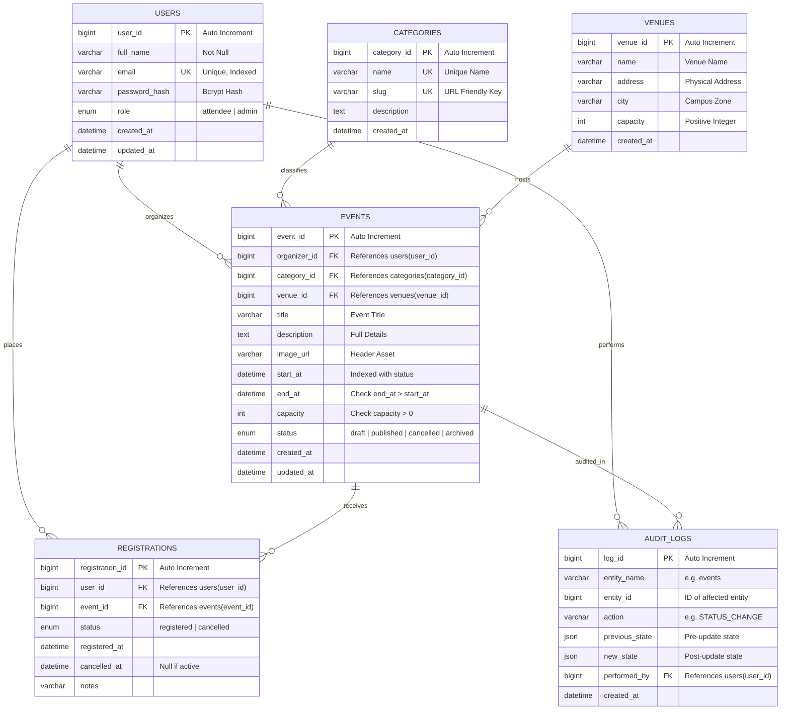

# Gatherly — Entity Relationship (ER) Diagram & Relational Mapping

## 1. Conceptual & Logical ER Model

## 2. Cardinalities & Relationship Rules
- **USERS to EVENTS (1:N)**: One user (administrator or campus organizer) can organize 0 or more events. Each event must have exactly one designated organizer (`ON DELETE RESTRICT`).
- **CATEGORIES to EVENTS (1:N)**: Each category classifies 0 or more events. Each event belongs to exactly one category (`ON DELETE RESTRICT`).
- **VENUES to EVENTS (1:N)**: Each physical venue can host multiple events over different time slots. Each event is assigned to one venue (`ON DELETE RESTRICT`).
- **USERS to EVENTS via REGISTRATIONS (M:N)**: An attendee can register for multiple events. An event can receive registrations from multiple attendees. This many-to-many relationship is resolved by the `registrations` associative entity with a composite business key `UNIQUE (user_id, event_id)`.
- **EVENTS to AUDIT_LOGS (1:N)**: Fired automatically by the database trigger `trg_event_status_audit` on lifecycle changes.

## 3. Normalization Justification
- **1NF (First Normal Form)**: All table attributes are atomic. No comma-delimited attendee lists or nested collections are stored in single cells.
- **2NF (Second Normal Form)**: All non-key attributes are fully functionally dependent on the entire primary key. In `registrations`, surrogate key `registration_id` is paired with `(user_id, event_id)` uniqueness.
- **3NF (Third Normal Form)**: No transitive dependencies exist between non-key attributes. Venue address, capacity, and organizer profiles are normalized in their respective tables rather than duplicated within `events`. Derived values like `remaining_capacity` and `occupancy_rate_pct` are dynamically computed in the `v_event_registration_summary` view rather than stored as redundant counters susceptible to desynchronization.
